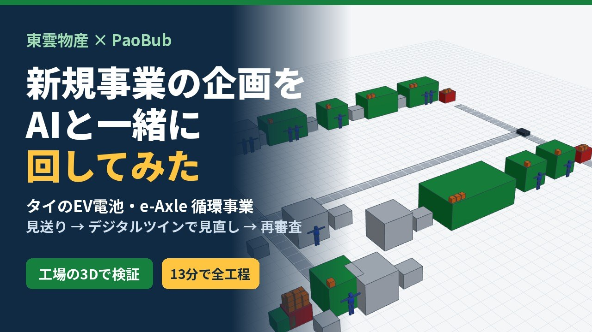
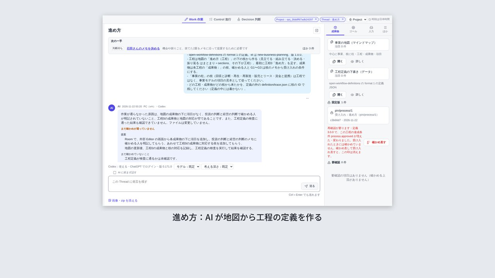
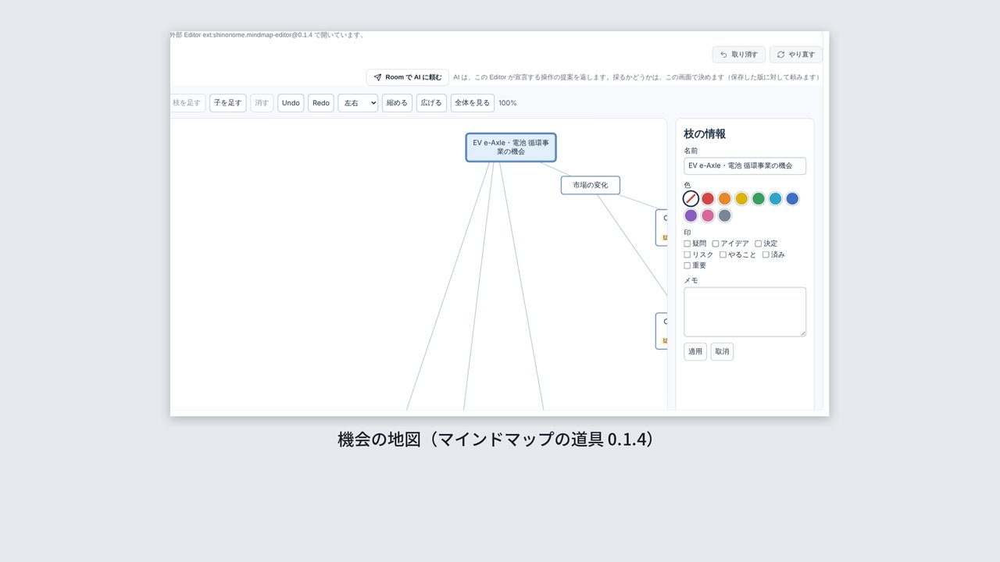
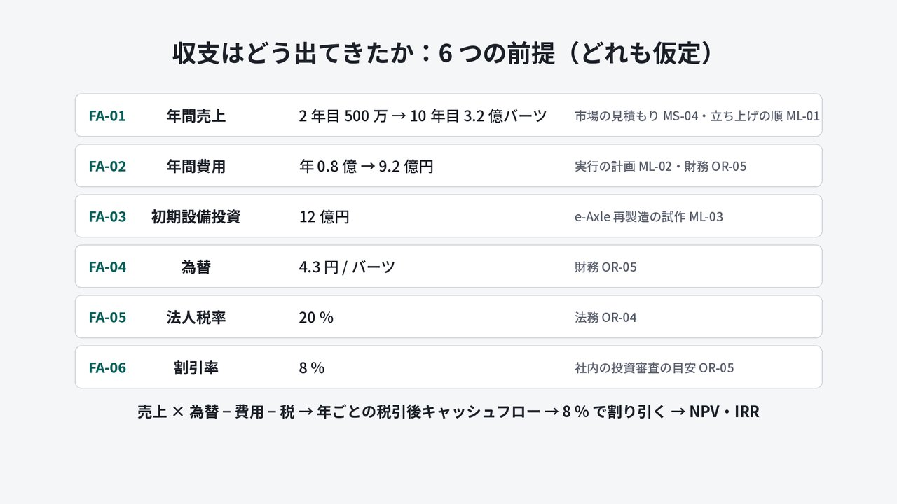
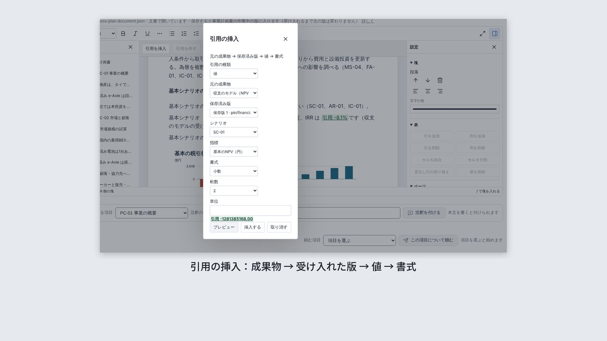
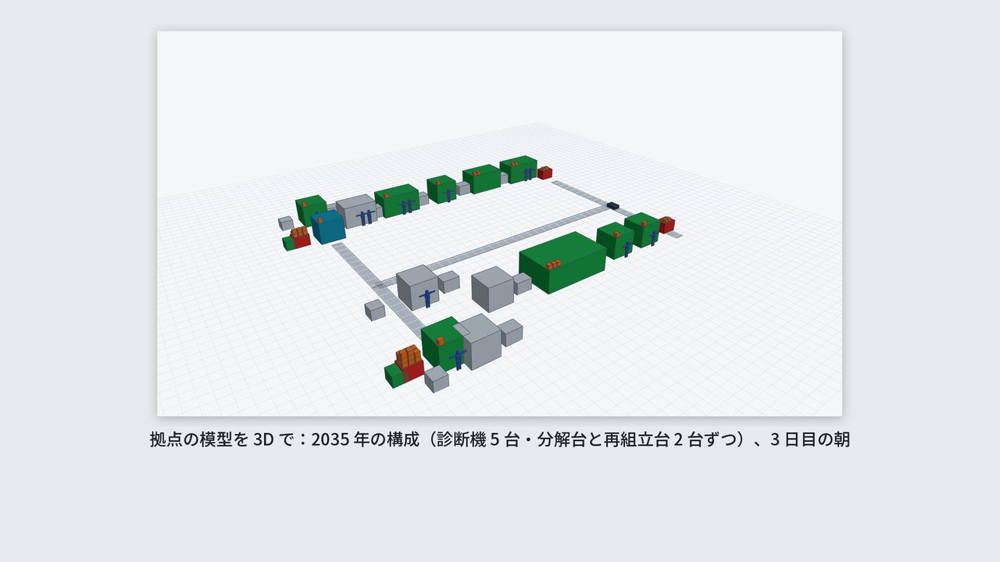
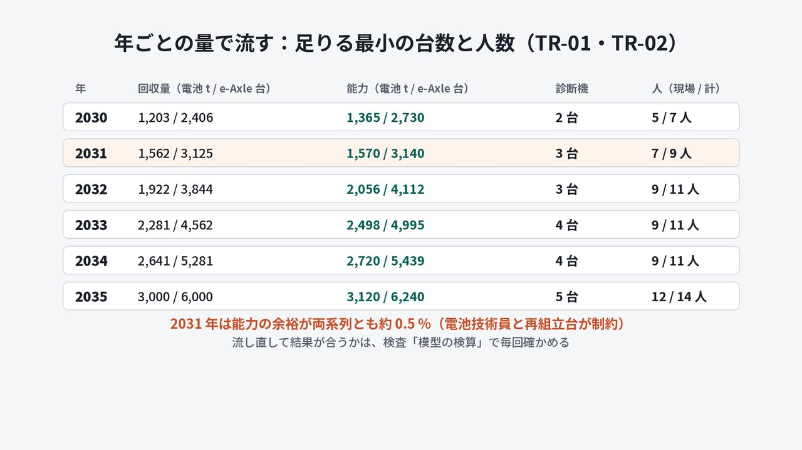
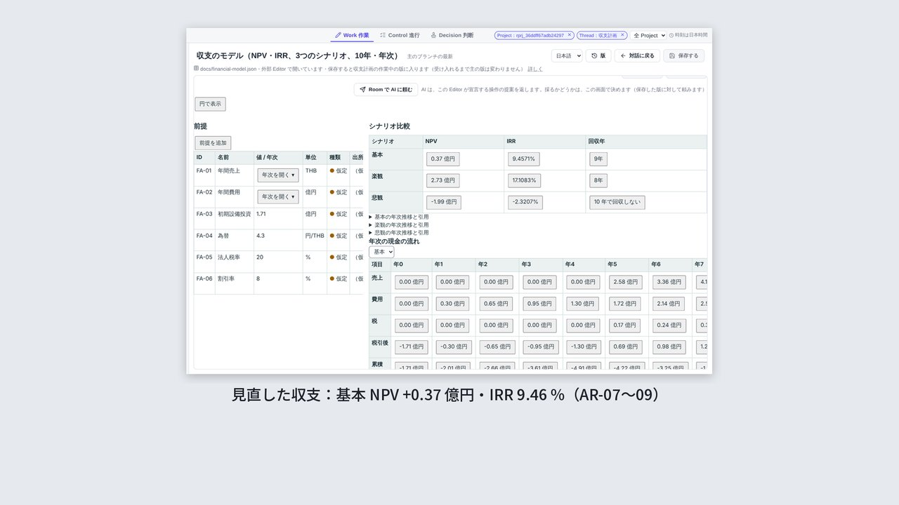
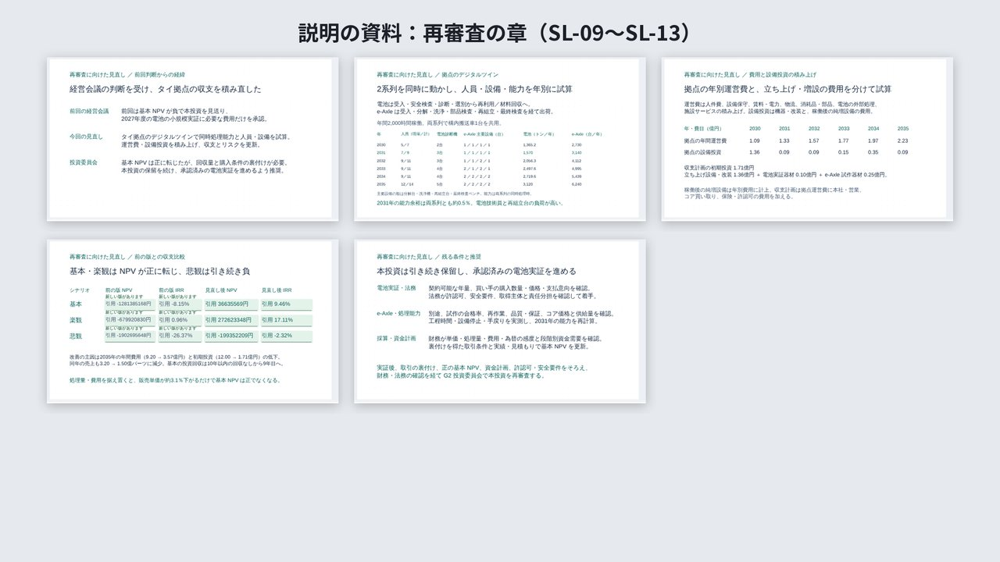

# 東雲物産の新規事業の企画（EV の e-Axle と電池の循環事業）

PaoBub の工程定義「新規事業の企画」（Project 内の定義 3.6.1、元は new-business-planning 1.0.0）で進めた、新規事業計画の Project です。

> **架空の題材です。** 総合商社「東雲物産」、担当者、提携先、数値はこの Project のために作ったものです。実在の商社・メーカー・人とは関係ありません。数字は、公表された実績・外部機関の予測・この企画の仮定・計算結果を区別して扱います。

- タイで使い終わった EV の電池と e-Axle を集め、診断・選別して、再利用・再製造・資源回収に回す循環事業を企画しました。
- 機会の探索から学びまで 13 工程を、早川（企画の責任者）・中川（DX）・石田（アナリスト）・佐藤（経理）・木村（法務）の役割で進め、全工程を受け入れました。AI の作業は作業役（Codex）が Runner で行いました。
- 途中で要る道具（マインドマップ、収支の道具、生きた引用）も、別の PaoBub の Project で作り、この Project で使いました。
- 最初の経営の判断（MD-01）は、基本の NPV が −12.8 億円で本投資を見送り、小規模実証の費用を承認。
- 「見直す」のまとまりで、再製造の拠点を工場のデジタルツイン（拠点の模型）で組み、年ごとの量で流して設備・人・費用を積み上げ、収支の道具で収支を入れ直しました。基本の NPV +0.37 億円・IRR 9.46%、悲観 −1.99 億円。再審査（MD-02）は、保留を続けて実証を進める判断です。

## 見どころ

| 見たいもの | ファイル |
| --- | --- |
| 工程定義（14 工程、うち「拠点の模型」は見送りのあとの見直し） | `definition.json`、定義の変更の記録は `trace/definition-changes.md` |
| 進め方と工程の地図（マインドマップ） | `docs/business-map.json` |
| 機会の地図・事業の仮説・市場と顧客 | `docs/opportunity-map.json`、`docs/business-hypothesis.md`、`docs/market-research.md` |
| 事業モデル・実行の計画 | `docs/business-model-map.json`、`docs/execution-plan.md` |
| 拠点の模型（工場のデジタルツイン、2030〜2035 年の量で流した結果 TR-01〜05） | `docs/plant-model.json`、流す道具と検算は `tools/twin/`（`node tools/twin/run.mjs docs/plant-model.json --check`） |
| 収支（収支の道具の形式。前提 FA・シナリオ SC・結果 AR） | `docs/financial-model.json`、形式は `docs/ref/` |
| リスクと対策・投資の判断 | `docs/risk-table.json`、`docs/investment-record.md` |
| 事業計画書と説明の資料（数値は収支から「生きた引用」） | `docs/business-plan-document.json`、`docs/presentation-slides.json` |
| 経営の判断（MD-01 見送り、MD-02 保留の継続）と学び | `docs/management-record.md`、`docs/learning-record.md` |
| 引用の表と注釈、受け入れの記録 | `trace/citations.json`（引用 213・例外 0）、`trace/annotations.json`、`trace/decisions/` |
| 画面 | `assets/*.jpg` |

## 開くときの注意

- ゲート「工程定義の検査」は、[open-workflow-definitions](https://github.com/ryo0221/open-workflow-definitions) を Project と同じ階層（`../open-workflow-definitions`）に複製してある前提です。
- ゲート「模型の検算」は node だけで動きます。

## 画面

| | |
| --- | --- |
|  進め方：AI が地図から工程の定義を作る |  機会の地図（マインドマップの道具） |
|  最初の収支の 6 つの前提 |  生きた引用の挿入 |
|  拠点の模型（2035 年の構成）を 3D で |  年ごとの量で流す |
|  収支の道具で入れ直した収支 |  再審査の説明の資料 |

## 宣伝動画

ナレーション付きの宣伝動画（13 分 36 秒、37 場面）は、`tools/video/` の道具で作りました。手順は `tools/video/README.md` にあります。動画のファイルはこのリポジトリに入れていません。

## 道具の課題

この Project で見つかった PaoBub・Editor Platform の課題（findings）は、それぞれのリポジトリの issue と PR で直しています。この Project の範囲で出た主なもの：

- 「この版で流し直す」という条件を AI が自分で満たせず回り続けた → 検算のゲート（`模型の検算`）にした。
- 作業役の答えの表が行ごとに分かれて注に入った。
- Editor で変えた値が `trace/citations.json` に反映されなかった。

## この版でまだ無いもの

- 実証の実績（2027 年度の小規模実証はこれから）。値はすべて推定か仮定です。
- 回収の拠点と経路の地図（geo）、立ち上げの日程（schedule）。
- スライドのアニメーション付きの書き出し（別の Project で作成中）。
